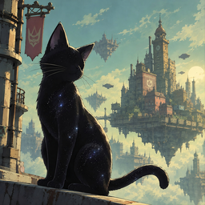

# Gravity Rush Remastered — Native PC Port

<p align="center">
  
</p>

<p align="center">
  <em>The PS4 game running natively on Windows: no emulator.</em>
</p>

## About

This project brings **Gravity Rush Remastered** (PS4, CUSA01113, tested with the European release
EP9000-CUSA01113_00) to PC as a native port.

There is no emulator: the game's original x86-64 executable runs directly on the PC's processor,
a runtime written for this port replaces the PS4 system libraries, and the graphics run on the
[shadPS4](https://github.com/shadps4-emu/shadPS4) video core, which translates the PS4 GPU commands
and shaders to Vulkan.

## Current Status

**Status: version 0.1.10 — the whole story has been played from start to finish with this port,
with sound and saves.**

**[Download the latest release](https://github.com/LucaPazienza/gravityrush_pc/releases/latest)** —
see [Playing](#playing) below.

Tested on Windows 11 with an NVIDIA RTX 5070 Ti, an Xbox One controller and a DualSense.

What works today:

- **Boot and story:** the whole game, from the title and the opening apple scene to the ending,
  has been played through with this port; dialogue, menus, movies and the upgrade shop.
- **Audio:** movies (AvPlayer) and the game's own sound engine on top of a real NGS2 sampler:
  PCM effects, ATRAC9 streamed music and ambience (wind, city), voice volume, pitch and panning,
  pause and resume, a mastering limiter, and a 7.1-to-stereo downmix for stereo devices.
- **Saves:** the save dialog, autosave, loading and manual saves; backups before every start.
- **Graphics:** Vulkan through the shadPS4 video core, readable text (font library with FreeType),
  borderless window by default (windowed and fullscreen, with a refresh rate choice).
  **Render resolution up to 4K** through patches of the game's own sizes and screen-space shader
  constants, **high-quality shadows** (4096 shadow map) and anisotropic filtering.
  **Anti-aliasing and upscaling:** the game's FXAA, TAA, **FSR 3.1** and **DLSS** (NVIDIA RTX), with
  Native/DLAA, Quality, Balanced and Performance modes that render below the screen and enlarge the
  image to it, the HUD kept as the game draws it. FSR 1.0 is available as a simple upscaler.
- **Input:** controllers through SDL3 (Xbox, DualSense and others), keyboard and mouse.
  **Mouse look**: the mouse turns the game's camera directly, on the ground and while floating,
  at once and by the mouse's own counts (its DPI), at any frame rate. Every button can be
  remapped on the controller and on the keyboard and mouse (two keys per button, Alt, Ctrl, Esc
  and the mouse buttons included); the gravity slide (L2 + R2) can sit on one key. The launcher
  plays with the controller, the keyboard and mouse, or both, and finds the connected controller.
  The touchpad works with real touch ids. The **DualSense gyro** steers the gravity camera like on
  the PS4 (adjustable sensitivity).
- **Launcher:** a dark window with a sidebar menu and pages in a card (game, video, controls,
  advanced, log), in English, Italian, French, German and Spanish; a mods folder of your choice. `Gravity Rush.exe` starts the game directly with the saved settings.
  The launcher finds new releases on GitHub by itself and installs them when the player agrees
  (saves, settings and mods are kept).
- **In-game menu** (Insert, or R3+L2): image options, performance and an FPS overlay.

Not done yet / known gaps:

- Only Nvidia graphics cards have been tested so far.
- Trophies are not saved or shown yet.
- **This port is developed for the European release only** (CUSA01113, version 01.00): every fix and
  enhancement is made and checked on that version. Other releases, such as the American one
  (CUSA01130), may start and play, but nothing specific to the port's work on the game applies to
  them: render resolution stays at 1080p (no higher resolutions, no upscaling modes that render
  below the screen), shadows stay at the game's quality, the gravity-shift camera may swing above
  60 FPS (a 60 FPS limit avoids it), and the mouse turns the camera through the right stick, with
  the game's own inertia, instead of directly.

### Roadmap

- [x] Native runtime: boot, title flow, graphics, text
- [x] Get past the opening scene
- [x] Audio: movies, effects, streamed music and ambience
- [x] Saves: load, autosave, manual save
- [x] Controller, touchpad and DualSense gyro
- [x] Launcher
- [x] Render resolution up to 4K, high-quality shadows
- [x] First preview release
- [x] First official release (0.1.2), with automatic updates
- [x] Play through the whole story and fix what breaks
- [ ] Trophies
- [ ] Performance and stability work

## Requirements

- Windows 10 (1903 or newer) or Windows 11, 64-bit.
- A graphics card with Vulkan 1.3 and a current driver.
- Your own legally acquired copy of Gravity Rush Remastered (PS4), as an unpacked game folder
  (eboot.bin, sce_module, sce_sys) that you prepare with your own tools. Tested with the European
  release CUSA01113, version 01.00: the port is developed for that version only (see the known
  gaps above).

## Playing

1. Download the Windows zip from [Releases](https://github.com/LucaPazienza/gravityrush_pc/releases)
   and extract it anywhere (not inside the zip).
2. Open **Gravity Rush Launcher.exe** (Windows may warn that the program is not signed: More info,
   Run anyway), choose your game folder on the Game page and press **Play**.
3. Later, **Gravity Rush.exe** starts the game straight away with the saved settings.
4. New versions: the launcher offers them when it opens (Advanced > Updates).

The Video page sets the render resolution (up to 4K), shadow quality and the display options.

### Reporting problems

Use the launcher's **Report a problem** button (Log page, or the notice after the game closes
unexpectedly): it opens the [report form](https://github.com/LucaPazienza/gravityrush_pc/issues/new/choose)
already filled in with the version and your graphics card, and the folder with `last_run.log` to
attach. If the picture goes wrong or the game freezes, press **F12** at that moment first (the frames
are saved in `user\screenshots`). Questions and impressions are welcome in
[Discussions](https://github.com/LucaPazienza/gravityrush_pc/discussions).

## Building and Running

1. Install [MSYS2](https://www.msys2.org) and, in the **MSYS2 CLANG64** shell, the packages listed
   in [packaging/windows/README.md](packaging/windows/README.md). Install
   [Python 3](https://www.python.org) with `pip install pillow cryptography`.
2. Build (newer CLANG64 toolchains need the standard headers forced for some third-party code):

   ```bash
   git clone --recursive https://github.com/LucaPazienza/gravityrush_pc
   cd gravityrush_pc
   CXXFLAGS="-include cstdlib -include cstdio -include cwchar -include cmath -include new" bash build.sh
   ```

3. Run the game (or start the launcher with `Gravity Rush Launcher.cmd`, or build
   `Gravity Rush Launcher.exe` and `Gravity Rush.exe` with `bash scripts/gr_build_launcher.sh`):

   ```powershell
   $env:GOW3_GAME_DIR = 'D:\path\CUSA01113'   # the game folder
   python run.py
   ```

The loader stops at the first PS4 system function the runtime does not implement and names it.

| Part | Where | What it does |
|---|---|---|
| Loader | `src/probe.c` | Loads the image and starts the game's original code |
| Runtime | `src/runtime_*.c`, `src/gr_*.inc` | PS4 system functions |
| GPU and libraries | `gpu/shadps4/` | shadPS4 video core (Vulkan), font library and AvPlayer |
| Preparation | `scripts/` | Reads `eboot.bin`, links the game's `libc` and `libSceFios2` |
| Launcher | `launcher/gravityrush_launcher.py`, `launcher/launcher_ui.py` | Settings, controls and the play button |
| Packaging | `packaging/windows/package.sh` | Builds the release zip (with the third-party licenses) |

Please do not add proprietary game files, disc images, executables, firmware, or other copyrighted
game data to this repository.

## Contributing

Contributions, technical research, bug reports, and documentation improvements are welcome.

Before opening an issue or pull request:

1. Check existing issues to avoid duplicates.
2. Include clear reproduction steps for bugs.
3. Separate confirmed findings from guesses or unverified observations.
4. Do not upload copyrighted game files or other proprietary assets.

## Credits and Acknowledgements

- **God of War Native Port** — technical starting point: [Waffle565/God-Of-War-Native-Port](https://github.com/Waffle565/God-Of-War-Native-Port)
  and [FelipePrado0/gow3_pc](https://github.com/FelipePrado0/gow3_pc), with their credits:
  Supermedo and deadinside28 (bloodborne_pc), cuesta4 (shadPS4 GPU fixes).
- **MediEvil PC port** — the fork this project grew from: [bc160201983/medievil_2019_pc_port](https://github.com/bc160201983/medievil_2019_pc_port).
- **shadPS4 team** — the video core, font and AvPlayer libraries, PKG format code and the NID
  name list.
- Launcher font: Cabin (SIL Open Font License).
- Also used: LibAtrac9, FFmpeg, FreeType, SDL3, Dear ImGui, sirit, magic_enum, miniz, xbyak,
  Vulkan Memory Allocator, FSR-Vulkan, MSYS2, LLVM, Pillow and cryptography.
- **Gravity Rush** — developed by Japan Studio and published by Sony Interactive Entertainment.

The inclusion of a project in this section does not imply endorsement or affiliation.

## License

GNU GPL v2 or later ([LICENSE](LICENSE)). Third-party components keep their own licenses.

## Disclaimer

This is an unofficial, community-driven project and is not affiliated with, endorsed by, or
sponsored by Sony Interactive Entertainment or Japan Studio. Gravity Rush and all related names,
characters, artwork, and other intellectual property belong to their respective owners.

This repository is intended for research, development, and game-preservation purposes. It does not
provide copyrighted game files. Users must obtain and use their own legally acquired copy of the game.
